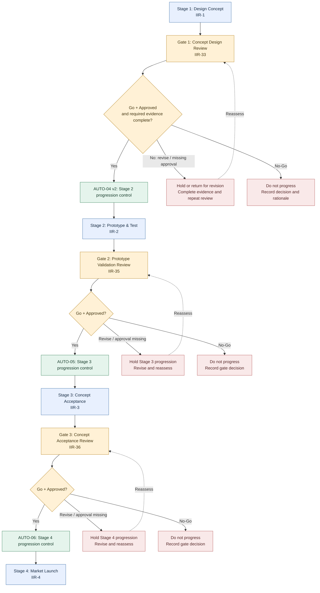
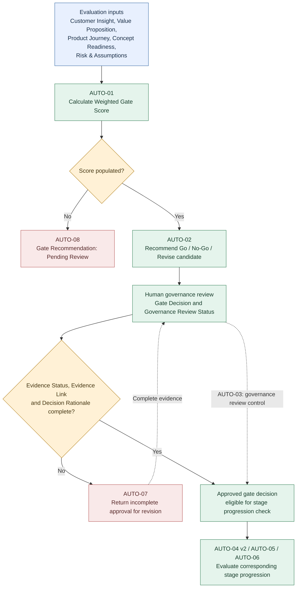

# Conceptual Stage-Gate System Flow — Innovation Implementation Roadmap

I designed this **conceptual process map** to show how the simulated innovation management system connects four Jira stages, three decision gates, automated recommendations, evidence requirements, human governance approval and controlled stage progression. The flow represents the intended operating logic and the documented portfolio configuration; it is **not** a full export of live Jira workflows or proof that every possible branch was executed.

## 1. End-to-end innovation roadmap

**Interpretation:** I use the decision diamonds to summarize governance prerequisites, **not** to claim that each Jira rule has one identical condition expression. In particular, the Gate 1 evidence requirement is documented explicitly; I have not independently re-exported and reconciled the precise enabled condition sets for all other gates. “No-Go” and “Revise” are conceptual decision outcomes, not claims of independently tested Jira transitions for each branch.

## 2. Cross-cutting gate decision and evidence logic

I treat the second diagram as a **logical overview**, not a universal execution order: triggers and applicability differ by automation rule. AUTO-07's required evidence fields are specifically documented for the Gate 1 test scenario. AUTO-03's exact current conditions still require Jira configuration reinspection. Recommendations from AUTO-02 do not substitute for the human Gate Decision.

## 3. Stage and gate traceability

| Sequence | Jira work item | Conceptual purpose | Governing control |
| --- | --- | --- | --- |
| Stage 1 | Design Concept (IIR-1) — Design Concept | Develop the innovation concept | Concept design work |
| Gate 1 | Concept Design Review — Gate 1 (IIR-33) — Concept Design Review | Review concept and required evidence before Stage 2 | AUTO-07; AUTO-04 v2 on Stage 2 |
| Stage 2 | Prototype & Test (IIR-2) — Prototype & Test | Develop and test the concept / MVP | AUTO-04 v2 |
| Gate 2 | Prototype Validation Review — Gate 2 (IIR-35) — Prototype Validation Review | Assess prototype validation before Stage 3 | AUTO-05 on Stage 3 |
| Stage 3 | Concept Acceptance (IIR-3) — Concept Acceptance | Evaluate acceptance and readiness | AUTO-05 |
| Gate 3 | Concept Acceptance Review — Gate 3 (IIR-36) — Concept Acceptance Review | Review readiness before Stage 4 | AUTO-06 on Stage 4 |
| Stage 4 | Market Launch (IIR-4) — Market Launch | Plan and execute launch work in the simulated roadmap | AUTO-06 |

**Supporting work packages recorded in the initial roadmap:** Customer Journey Mapping (IIR-5), Product Journey Mapping (IIR-6), Value Map Development (IIR-7), MVP Development & Validation (IIR-8), Value Proposition Design (IIR-9), Cost-Benefit Analysis (IIR-10), Use Case Development (IIR-11), Industrial Feasibility Assessment (IIR-12), Business Case Development (IIR-13), Market Segmentation (IIR-14), Ecosystem & Unit Cost Analysis (IIR-15), Market Potential & Market Share Assessment (IIR-16), and Target Price Definition (IIR-17). I list these as **documented work packages**, not as verified current stage assignments or completed deliverables. The complete live Jira issue hierarchy has not been reconciled.

## 4. Verification boundary and observed example

In the **16 October 2026 AUTO-04 v2 follow-up**, I populated the Gate 1 evidence prerequisites on Concept Design Review — Gate 1 (IIR-33), set the simulated decision to **Go** and governance status to **Approved**, and retested the Stage 2 control. I observed that AUTO-04 v2's blocking condition did not match and that **Prototype & Test (IIR-2) remained In Review after refresh**. I do not describe that observed status as In Progress, nor equate an automation audit “Success” with verified end-to-end business progression.

- [Gate 1 concept-review evidence](gate-1-concept-review-evidence.md)
- [Automation rule catalog](../03-automation-rules/automation-rule-catalog.md)
- [Governance and decision traceability](../03-automation-rules/governance-and-traceability.md)
- [Integration test report](../04-testing-validation/integration-test-report.md)
- [Evidence traceability matrix](../04-testing-validation/evidence-traceability-matrix.md)
- [AUTO-04 v2 audit history](../assets/evidence/EVID-24-AUTO-04-v2-Audit-History.png)
- [Gate 1 approved configuration](../assets/evidence/EVID-25-AUTO-04-Gate1-Approved-Configuration.png.png)
- [AUTO-04 test C](../assets/evidence/EVID-26-AUTO-04-Test-C-Condition-Not-Matched.png.png)

## 5. AI assistance and ownership

I used AI to help structure and check this visual documentation against the recorded project artifacts. I designed the simulated system, configured Jira, tested the scenarios, reviewed the evidence and retain responsibility for the accuracy of the portfolio. The diagrams are **conceptual models** of a simulated system, not independent validation of a production deployment.
