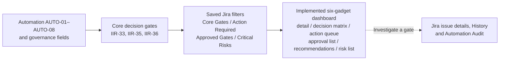
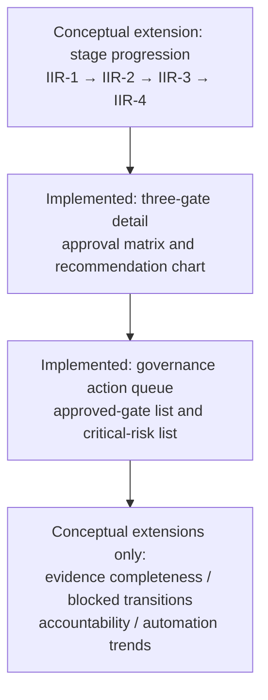

# Innovation Governance Dashboard — Conceptual Blueprint and Implementation Alignment

I designed this management-information blueprint for my simulated Innovation Implementation Roadmap (IIR). It explains how the implemented Jira governance dashboard relates to the broader Stage-Gate operating model. I distinguish **implemented and validated views** from **conceptual extensions**; this document is not an export of Jira configuration or evidence of enterprise deployment.

## 1. Implemented and validated dashboard

On 16 October 2026, I reviewed the final six-gadget **Innovation Implementation Governance Dashboard** in Jira (`/jira/dashboards/10001`). The management scope is limited to the three core gates: IIR-33 (Gate 1), IIR-35 (Gate 2) and IIR-36 (Gate 3). I excluded test issues IIR-34 and IIR-37 from the core management statistics.

| Implemented gadget | Management question | Validated snapshot |
| --- | --- | --- |
| Core Innovation Gates — Filter Results | What is each gate's decision, approval and workflow state? | Three gates: IIR-33 Done / Go / Approved; IIR-35 In Progress / Go / Returned for Revision; IIR-36 To Do / Go / Returned for Revision |
| Two Dimensional Filter Statistics | How do approval and gate decisions intersect? | Approved + Go: 1; Returned for Revision + Go: 2; total 3 |
| Governance Action Required — Filter Results | Which gates require governance action? | IIR-35 and IIR-36; total 2 |
| Approved Innovation Gates — Filter Results | Which gates have Go and Approved together? | IIR-33 only; total 1 |
| Gate Recommendation — Pie Chart | What are the automated recommendations? | Pending Review: 2; Go Candidate: 1; total 3 |
| Critical Innovation Risks — Filter Results | Which core gates have the critical-risk flag? | No matching core gates at the final refresh |

These are observed **snapshot values**, not continuous KPIs or production business results. A `Go` gate decision does not by itself mean governance approval. A zero critical-risk count is limited to the configured core-gate filter and refresh time.

The [final dashboard implementation review](dashboard-implementation-review.md) contains the exact saved JQL, validation method, limitations and screenshots:

- [DASH-01 — six-gadget overview](../assets/evidence/DASH-01-Innovation-Governance-Dashboard-Overview.png)
- [DASH-02 — core-gate detail and decision matrix](../assets/evidence/DASH-02-Core-Gates-and-Decision-Matrix.png)

## 2. Implemented information flow

The dashboard uses saved-filter results and field-based gadget groupings. Jira issue History and Automation Audit are separate verification sources; I do not claim that they are embedded as live audit gadgets. I validated the final core-gate counts and six-gadget layout, not every possible future automation-triggered refresh or permission scenario.

### Saved filter scope

I used `IIR | Core Innovation Gates` for the three-gate detail table, decision matrix and recommendation pie chart. I used `IIR | Governance Action Required`, `IIR | Approved Innovation Gates` and `IIR | Critical Innovation Risks` for the respective exception and approval lists. I retained the broader `IIR | All Innovation Decision Gates` and `IIR | Gates Under Review` saved filters without displaying their redundant or test-inclusive gadgets in the final management view. See the [verified JQL definitions](dashboard-implementation-review.md#saved-jql-and-scope).

## 3. Conceptual extensions — not implemented dashboard gadgets

I also designed the following potential management views. They illustrate future information architecture, **not** deployed or independently validated dashboard capabilities.

| Conceptual extension | Management question | Source or constraint |
| --- | --- | --- |
| Stage progression overview | Where are IIR-1 through IIR-4 in the roadmap? | Stage work items and statuses; no dedicated validated stage-progression gadget |
| Portfolio-wide evidence completeness | Which gate decisions lack supporting evidence? | Evidence Status, Evidence Link, Decision Rationale and AUTO-07; Gate 1 evidence scenario tested, not an aggregated dashboard |
| Blocked transition monitoring | Which Stage 2/3/4 transitions require intervention? | AUTO-04 v2, AUTO-05, AUTO-06; no validated cross-stage exception gadget |
| Decision accountability and chronology | Who approved which decision, when and why? | Jira issue History and available governance fields; no universal dashboard or complete decision-owner dataset verified |
| Automation health and audit trends | Are governance rules failing or misfiring over time? | Jira Automation Audit; no implemented dashboard trend gadget |
| Weighted evaluation detail | How did individual criteria contribute to a score? | AUTO-01 weighted scoring; no dedicated criteria-breakdown gadget validated |

The arrows describe a suggested **management reading order**, not Jira automation execution or proof that the conceptual panels exist.

## 4. Example: Gate 1 and Stage 2 control

I used Gate 1 (IIR-33) and Stage 2 (IIR-2) to examine the interaction between evidence completeness (AUTO-07) and stage progression control (AUTO-04 v2). In the 16 October follow-up, an incomplete Gate 1 approval was returned for revision. After I populated the simulated evidence prerequisites and restored Go / Approved, the AUTO-04 v2 blocking condition did not match; I confirmed **IIR-2 remained In Review after refresh**. I do not equate this with a verified transition to In Progress. See the [Gate 1 evidence record](../01-system-design/gate-1-concept-review-evidence.md) and [integration report](../04-testing-validation/integration-test-report.md).

## 5. Verification boundary and ownership

I checked the final dashboard's six gadgets, the three-core-gate scope and cross-gadget totals. I tested the critical-risk saved filter with a reversible flag change on IIR-37 and restored its original value; the final dashboard's core-gate risk list correctly showed no matching items. I have not validated multi-user permissions, every future refresh scenario or the conceptual extensions.

I used AI to support information architecture, JQL troubleshooting, validation planning and documentation. I configured Jira, executed checks, reviewed the screenshots and retain responsibility for the conclusions.

Related: [dashboard implementation review](dashboard-implementation-review.md) · [Stage-Gate system flow](../01-system-design/conceptual-stage-gate-flow.md) · [automation catalog](../03-automation-rules/automation-rule-catalog.md) · [evidence matrix](../04-testing-validation/evidence-traceability-matrix.md).
