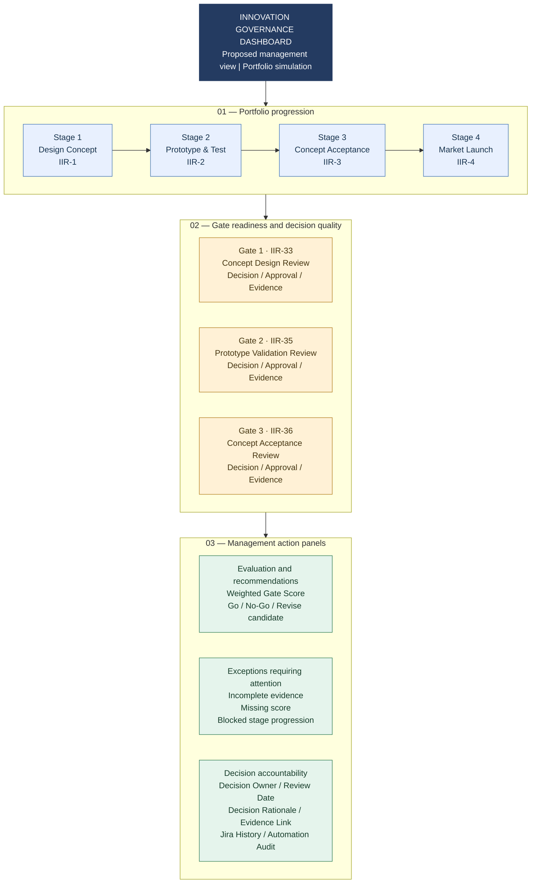
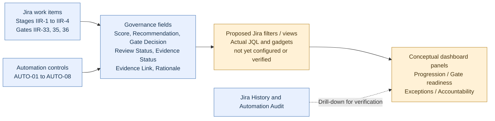

# Innovation Governance Dashboard — Conceptual Blueprint

I designed this **conceptual dashboard blueprint** to explain how a manager could monitor the simulated Innovation Implementation Roadmap (IIR) governance system through Jira. It connects the four documented stages, three decision gates, evidence requirements and eight automation controls to decision-oriented dashboard views.

**Implementation boundary:** This is a proposed information architecture, **not a screenshot, Jira dashboard configuration export, live data feed or verified deployed dashboard**. The repository currently documents workflow automation and testing, not a completed dashboard implementation. I intentionally show **no invented counts, percentages, KPIs or trend values**.

## 1. Proposed management dashboard layout

The diagram below is a **wireframe**, not a real Jira screen. Each box represents a proposed dashboard panel; labels are grounded in the Jira issues and governance fields documented for this portfolio.

**How to read it:** I would use the top row to orient the viewer in the innovation roadmap, the middle row to inspect whether formal gates are ready for decision, and the bottom row to identify the next management action. The arrows express a proposed **reading hierarchy**, not Jira automation dependencies.

## 2. How information would reach the dashboard

This is a **proposed data flow**. I have not verified the availability of each field in a particular Jira dashboard gadget, created JQL filters, connected gadgets or tested dashboard refresh behavior. Jira History and Automation Audit should be inspected in their appropriate Jira views rather than assumed to be natively embedded as live dashboard gadgets.

## 3. Dashboard panel specification

| Proposed panel | Management question | Source / logic in the documented system | Implementation status |
| --- | --- | --- | --- |
| Stage progression | Where is the innovation initiative in the roadmap? | IIR-1 through IIR-4 and their issue statuses | Conceptual view; live dashboard not verified |
| Gate readiness | Which gate is ready for a formal decision? | IIR-33, IIR-35, IIR-36; Gate Decision, Governance Review Status and evidence fields | Conceptual view; actual filter not verified |
| Evaluation quality | What is the weighted assessment and recommendation? | Weighted Gate Score (AUTO-01), Gate Recommendation (AUTO-02), missing-score reset (AUTO-08) | Source controls documented; visualization proposed |
| Evidence completeness | Is the approval supported by the required evidence? | Evidence Status, Evidence Link, Decision Rationale; AUTO-07 | Gate 1 scenario documented; portfolio-wide completeness view proposed |
| Blocked transitions | Which next-stage progression requires intervention? | AUTO-04 v2 (Stage 2), AUTO-05 (Stage 3), AUTO-06 (Stage 4) | Controls documented; aggregated dashboard view proposed |
| Governance accountability | Who approved what, why and when? | Gate Decision, Governance Review Status, Decision Rationale, Review Date, Decision Owner (where available), Jira History | Field availability varies; no universal completed record claimed |
| Automation exceptions | What needs technical follow-up? | Automation Audit and issue History, including mismatched conditions | Evidence available; dashboard integration not implemented |

I do **not** claim that these panels already exist in Jira or that a management KPI has been calculated. This specification is intended to make the future dashboard testable.

## 4. Example management reading path — documented Gate 1 scenario

1. **Identify the gate:** Gate 1 is represented by IIR-33 and controls entry into Stage 2 (IIR-2).
2. **Inspect evidence and approval:** In the simulated positive-path test I populated Evidence Status, Evidence Link and Decision Rationale, then used Go and Approved for the governance decision.
3. **Inspect the control:** AUTO-07 had previously reset an incomplete approval. After completing the evidence, I retested AUTO-04 v2.
4. **Check actual issue behavior:** I observed the AUTO-04 v2 blocking condition did not match and **IIR-2 remained In Review after refresh** on 16 October 2026.
5. **Escalate or close the exception:** A dashboard could link a manager to the underlying Jira item and audit evidence, but that dashboard drill-down has **not** been implemented or tested.

See the [Gate 1 evidence record](../01-system-design/gate-1-concept-review-evidence.md) and [AUTO-04 v2 test evidence](../assets/evidence/EVID-26-AUTO-04-Test-C-Condition-Not-Matched.png.png).

## 5. Practical Jira implementation roadmap (future work)

| Step | Proposed action | Acceptance criterion |
| --- | --- | --- |
| 1 | Confirm the available Jira project fields, permissions and issue types | Verified field inventory and allowed viewers |
| 2 | Define saved JQL filters for stages, gates and exceptions | Each filter returns the intended simulated issues |
| 3 | Create a Jira dashboard and choose supported gadgets | Dashboard exists and its gadgets load without errors |
| 4 | Configure gate-readiness and exception views | Counts and displayed fields reconcile to Jira work items |
| 5 | Test a changed gate decision and an incomplete-evidence case | Views refresh appropriately and lead to correct issue records |
| 6 | Capture screenshots, privacy-review them and add an evidence register | Dashboard implementation is demonstrable and auditable |

These are **future implementation steps**, not completed project achievements.

## 6. Related documentation and accountability

- [Conceptual Stage-Gate process flow](../01-system-design/conceptual-stage-gate-flow.md)
- [Jira implementation architecture](../02-jira-implementation/README.md)
- [Automation rule catalog](../03-automation-rules/automation-rule-catalog.md)
- [Governance and traceability](../03-automation-rules/governance-and-traceability.md)
- [Evidence traceability matrix](../04-testing-validation/evidence-traceability-matrix.md)
- [AI assistance and human validation](../05-ai-contribution/ai-assistance-and-human-validation.md)

I used AI to help organize the conceptual visualization and documentation. I remain responsible for the design and for distinguishing **proposed dashboard capabilities** from **Jira behavior I actually configured and verified**.
