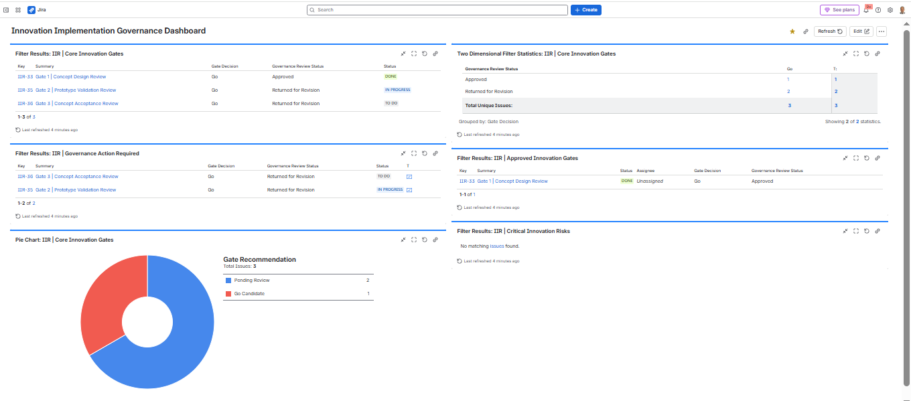
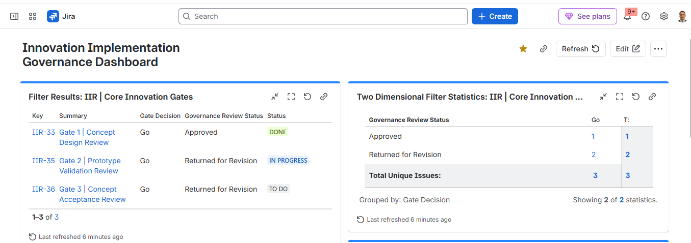

# Jira Innovation Governance Dashboard — Final Implementation Review

I designed, configured and validated an **implemented Jira Cloud dashboard** for my simulated Innovation Implementation Roadmap. My final dashboard is available in my Jira environment at `/jira/dashboards/10001`. I reviewed the final layout on 16 October 2026.

## Scope and management purpose

I designed the final employer-facing dashboard around **three core governance gates**: Concept Design Review — Gate 1 (IIR-33), Prototype Validation Review — Gate 2 (IIR-35) and Concept Acceptance Review — Gate 3 (IIR-36). I retained test gate (IIR-34) and test decision gate (IIR-37) as test issues in Jira but excluded them from the core management view. I preserved the broader saved filter `IIR | All Innovation Decision Gates` for test traceability.

## Final dashboard — six gadgets

| Gadget | Filter / grouping | Verified snapshot |
| --- | --- | --- |
| Core Innovation Gates — Filter Results | `IIR | Core Innovation Gates` | Concept Design Review — Gate 1 (IIR-33) Done / Go / Approved; Prototype Validation Review — Gate 2 (IIR-35) In Progress / Go / Returned for Revision; Concept Acceptance Review — Gate 3 (IIR-36) To Do / Go / Returned for Revision |
| Two Dimensional Filter Statistics | `IIR | Core Innovation Gates`; Governance Review Status × Gate Decision | Approved / Go: 1; Returned for Revision / Go: 2; total 3 |
| Governance Action Required — Filter Results | `IIR | Governance Action Required` | Prototype Validation Review — Gate 2 (IIR-35) and Concept Acceptance Review — Gate 3 (IIR-36); total 2 |
| Approved Innovation Gates — Filter Results | `IIR | Approved Innovation Gates` | Concept Design Review — Gate 1 (IIR-33) only; total 1 |
| Gate Recommendation — Pie Chart | `IIR | Core Innovation Gates`; Gate Recommendation | Pending Review: 2; Go Candidate: 1; total 3 |
| Critical Innovation Risks — Filter Results | `IIR | Critical Innovation Risks` | No matching core gate at final refresh |

These are **snapshot results**, not organization-wide metrics or a claim of production impact. A recorded `Go` decision is distinct from governance approval and workflow completion. A zero critical-risk result means only that no **core gate** matched the configured risk flag at the time of refresh.

## Saved JQL and scope

**Core Innovation Gates**

```jql
project = IIR
AND key in (IIR-33, IIR-35, IIR-36)
ORDER BY created ASC
```

**Governance Action Required**

```jql
project = IIR
AND key in (IIR-33, IIR-35, IIR-36)
AND "Governance Review Status" in ("Under Review", "Returned for Revision")
ORDER BY updated DESC
```

**Approved Innovation Gates**

```jql
project = IIR
AND key in (IIR-33, IIR-35, IIR-36)
AND "Gate Decision" = "Go"
AND "Governance Review Status" = "Approved"
ORDER BY updated DESC
```

**Critical Innovation Risks**

```jql
project = IIR
AND key in (IIR-33, IIR-35, IIR-36)
AND "Critical Risk Flag" = "Critical Risk Identified"
ORDER BY updated DESC
```

I also retained `IIR | Gates Under Review` as a saved filter but removed its redundant gadget. I did not delete the historical five-item filter or test issues.

## Verification performed

1. I checked that the core-gate JQL returned Concept Design Review — Gate 1 (IIR-33), Prototype Validation Review — Gate 2 (IIR-35) and Concept Acceptance Review — Gate 3 (IIR-36) only.
2. I compared the three-row detail gadget with the decision matrix, approval list, action queue and pie-chart totals.
3. I tested the critical-risk filter using the Test Decision Gate (IIR-37): `No Critical Risk` → `Critical Risk Identified` → `No Critical Risk`. The filter returned 0 → 1 → 0 matching issues. I subsequently confirmed that the dashboard risk gadget returned zero after refresh.
4. I checked the final six-gadget layout and removed the redundant `Gates Under Review` gadget and the five-item test-inclusive table from the employer-facing dashboard.

**Verification boundaries:** I did not independently test every future automation-triggered update, every permission scenario or a production organization's risk coverage. The positive risk test verified the saved filter with a test issue; the final core-only gadget correctly excluded that issue. All listed counts are from the observed Jira simulation.

## Selected visual evidence

I selected two screenshots for the final portfolio and uploaded both to `assets/evidence/` on `main`. I verified their exact repository paths. They are linked below; this documentation PR does not duplicate the binary files.



*Figure 1 — Complete six-gadget dashboard, with three core gates only.*



*Figure 2 — Readable core-gate detail and governance review matrix.*

## AI contribution and accountability

I used AI to support dashboard design review, JQL troubleshooting, validation planning and documentation. I personally configured the Jira dashboard, performed the controlled test, reviewed the results and remain responsible for the conclusions.
