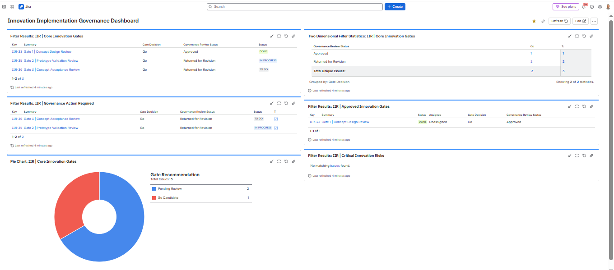

# Innovationsmanagement mit Jira — Portfolio-Projekt

Ich habe ein **simuliertes Stage-Gate-System** für das Innovationsmanagement in Jira Cloud entwickelt und dokumentiert.  
**Ausgangsproblem:** Innovationsideen benötigen transparente Bewertungskriterien, nachvollziehbare Entscheidungen und klare Verantwortlichkeiten.  
**Meine Lösung:** Vier Entwicklungsphasen, drei Entscheidungsgates, acht Automatisierungsregeln und ein Governance-Dashboard.  
**Ergebnis:** Ein funktionsfähiger Portfolio-Prototyp mit dokumentierten Tests und Screenshots – keine produktive Einführung in einem Unternehmen.

Die Bewertung kombiniert fünf gewichtete Kriterien. Automatisierungen berechnen Ergebnisse und unterstützen Prüfungen; die endgültige Gate-Entscheidung bleibt bei den verantwortlichen Personen.

Das Dashboard zeigt den Status der drei zentralen Gates, erforderliche Maßnahmen, Empfehlungen und Risikohinweise.

Mit dem Projekt demonstriere ich Kenntnisse im **Innovationsmanagement**, in der **Jira-Projektsteuerung** und im **verantwortungsvollen KI-Einsatz**.

Für eine Kommune wäre das Modell beispielsweise bei der Bewertung digitaler Verwaltungsprojekte denkbar; ein mittelständisches Unternehmen könnte damit Produktideen und Prototypen steuern. Die Übertragung ist ein Konzept, keine nachgewiesene Einführung.

Ich habe Jira selbst konfiguriert, Tests ausgeführt und Ergebnisse geprüft. KI unterstützte mich bei Konzeption, Fehlersuche und Dokumentation.

Die ergänzende Testdokumentation und Konfigurationsexporte werden schrittweise erweitert.

**Weitere Informationen:** [Vollständige englische README](README.md) · [Praxisübertragung und RACI](07-transferability/real-world-adoption.md) · [Projektumfang](SCOPE-AND-LIMITATIONS.md)
