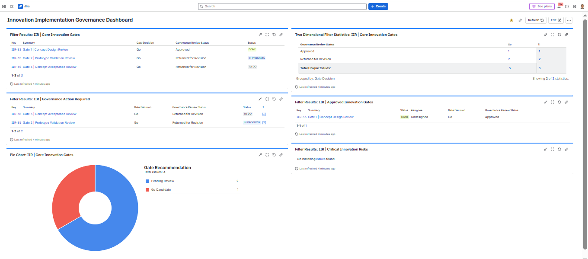

# Innovation Management System — Jira Portfolio Case Study

**Problem:** Innovation ideas can stall when evaluation criteria, evidence and decision ownership are unclear.  
**Solution:** I built a simulated Stage-Gate governance workflow in Jira with weighted scoring, review controls, automation and management reporting.  
**Result:** An implemented eight-control Jira portfolio model, a six-gadget governance dashboard and traceable examples of tested rule behavior—not a claim of production business impact.

*My Jira governance dashboard: three core decision gates, approval status, action queue, recommendations and risk indicators.*

[Deutsche Zusammenfassung](README.de.md) · [System flowchart](01-system-design/conceptual-stage-gate-flow.md) · [Evidence](04-testing-validation/evidence-traceability-matrix.md)

## What I built

I wanted to show how an innovation management concept becomes an operational process rather than remaining a slide deck. In this independent **portfolio simulation**, I designed four development stages and three decision gates, configured Jira work items and automation rules, and built a dashboard that makes governance decisions visible.

| Capability | My implementation | Inspect it |
| --- | --- | --- |
| Innovation governance | Stage-Gate model, decision criteria, evidence requirements and human approvals | [Process map](01-system-design/conceptual-stage-gate-flow.md) · [Governance design](03-automation-rules/governance-and-traceability.md) |
| Jira implementation | Eight automation controls (AUTO-01–AUTO-08), including weighted scoring and stage-transition guards | [Rule catalog](03-automation-rules/automation-rule-catalog.md) · [Configuration availability](config/README.md) |
| Management reporting | Six-gadget dashboard scoped to Gate 1, Gate 2 and Gate 3 | [Dashboard review](06-dashboard/dashboard-implementation-review.md) · [Decision matrix image](assets/evidence/DASH-02-Core-Gates-and-Decision-Matrix.png) |
| Testing and evidence | Observed scoring result **3.85** (TC-01) and a permitted manual Stage 2 transition (TC-04), with audit and History screenshots | [Verified cases](04-testing-validation/verified-followup-tests-2026-10-16.md) · [Evidence matrix](04-testing-validation/evidence-traceability-matrix.md) |
| Responsible AI use | AI supported design, troubleshooting and documentation; I performed Jira configuration, tests and final review | [AI contribution](05-ai-contribution/ai-assistance-and-human-validation.md) |

In the dashboard snapshot, **one core gate was Approved and two were Returned for Revision**. These are observed simulation states, not enterprise performance metrics.

## How the system works

I evaluate innovation concepts using five weighted criteria. Automation can calculate a score and propose a recommendation, but the **Gate Decision and governance approval remain human responsibilities**. Evidence checks can return an incomplete review for revision, while stage controls can block or roll back transitions that do not meet the gate conditions. The [conceptual process map](01-system-design/conceptual-stage-gate-flow.md) distinguishes this operating model from the exact live Jira rule expressions.

## Glossary

| Term | Meaning |
| --- | --- |
| **IIR** | Innovation Implementation Roadmap; prefix of the simulated Jira project issues (e.g., IIR-33). |
| **AUTO-01–08** | Identifiers I use for the eight documented Jira automation controls. |
| **Gate 1 / 2 / 3** | Concept Design Review (IIR-33), Prototype Validation Review (IIR-35), and Concept Acceptance Review (IIR-36). |
| **TC** | Test Case; e.g., TC-01 tests weighted scoring and TC-04 tests the permitted Stage 2 guard path. |
| **RACI** | Responsible, Accountable, Consulted and Informed; a suggested responsibility model for real adoption. |

## Transferability to real organizations

I designed the workflow as a reusable governance pattern. A **German municipality (Kommune)** could use decision gates to review digital-service initiatives against citizen value, feasibility, data protection and budget requirements. A **Mittelstand company** could apply the same structure to product concepts, prototypes and market-launch decisions. Neither use case is presented as an actual deployment. I describe practical stakeholders, a proposed RACI and adoption risks in [Transferability to municipalities and SMEs](07-transferability/real-world-adoption.md).

## Current status and next steps

The Jira model, dashboard, automation catalog and selected test evidence are available in this repository. I am continuing to update the broader integration-test evidence and will upload the remaining case-level records as part of the next project iteration. I will also add source configuration exports after retrieving and reviewing them from Jira.

For the publication boundary and next steps, see [Scope & Limitations](SCOPE-AND-LIMITATIONS.md) and [Roadmap](ROADMAP.md). For a concise history of portfolio improvements, see [Changelog](CHANGELOG.md).

**Project ownership:** I designed and executed this independent simulation. AI assisted with planning, troubleshooting and writing; the Jira actions, evidence review and final conclusions are mine.
